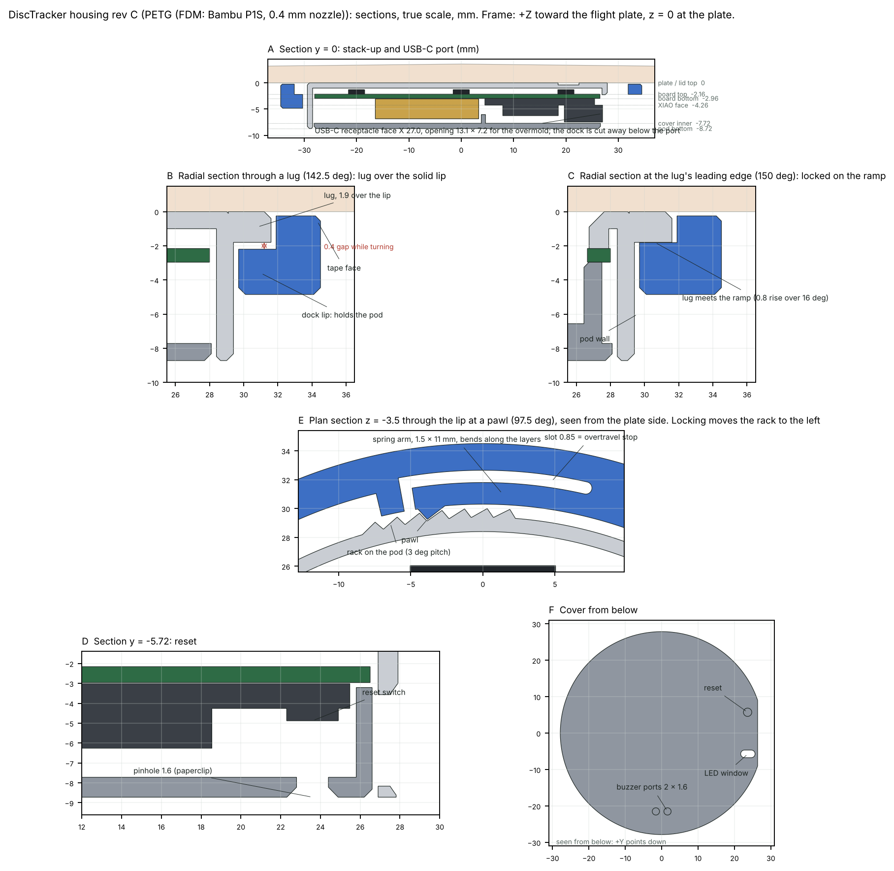

# DiscTracker housing, rev C

The pod twists into a dock glued under each disc: a 30° turn that clicks as it tightens. Every housing part prints flat on a Bambu P1S in PETG, with no supports.
Built in CadQuery (`housing.py`); open the STEP files in SolidWorks.



## Why rev C

Rev B was designed for MJF nylon. Printed in PETG on a P1S (v2), it failed in three ways:
- **It broke.** The latch arms and the dock's window bars bent across the print layers, which is PETG's weakest direction. PETG also only takes about 1.5 % strain over and over, against PA11's 6.7 %.
- **It didn't click.** The snap relied on 0.5 mm of finger preload and a 1 mm catch. FDM's ±0.2 mm and rounded edges ate most of it.
- **It fell out on landing.** With the catch gone, only friction held the pod.

Rev C holds the pod with geometry, not flex:
- Three solid lugs sit over a solid lip, 1.9 mm deep.
- The only springs are three small click arms. They bend in the plane of the layers, less than 1 % per click.
- A tolerance error only changes how far the pod turns before it's tight. It doesn't change how well it holds.

## Parts

| File (`out/`) | What | Print |
|---|---|---|
| `pod.step/.stl` | Lid, wall, USB-C flat and port, three lugs, three ratchet racks, grip ribs, three screw bosses | lid down |
| `cover.step/.stl` | Bottom cover: reset pinhole, LED window with light shroud, buzzer chamber with two ports, battery cage, three screw columns | outer face down |
| `dock.step/.stl` | Ring glued under the disc: lip with three notches, ramps and end stops, three click arms, a cut-out under the USB-C port | tape face up |
| `test_ring.step/.stl` | Just the top of the pod (lugs, racks, wall). A 20-minute print to check the twist | lid down |
| `jig_frame`, `jig_plunger` | Gluing jig: the frame centres itself on the rim, the plunger carries the dock to the plate | frame spokes down with supports under the hub; plunger head down |
| `housing_assembly.step` | Dock, pod and cover with the board, XIAO and battery in place | |
| `report.json` | Every fit and gap (nominal, RSS, worst case), forces, torques, strains, masses, balance, interference checks | |

`viewer/index.html` is the 3D viewer (with an animation of the lock); `sections.py` draws `renders/sections.png`.

## How it works

**Twist in.**
1. Hold the pod with its USB-C port at 11 o'clock to the gap in the dock.
2. Push it up. The three lugs drop through the dock's notches. The wide lug only fits the wide notch, so it only goes in one way.
3. Turn it clockwise (seen from below) to 12 o'clock, where the port lines up with the gap.
   - On the way, it clicks every 3° as three spring pawls in the dock ride over racks on the pod.
   - The lugs climb helical ramps on the lip until the lid is tight against the disc.
   - An end stop 10° past nominal stops it going further.

**Stays in.**
- A landing can't pull the pod out: the lugs would have to break, and the tape lets go first.
- A tree hit that stops the spin dead tries to unscrew it with about 0.35 N·m. The clicks alone hold 0.37–0.75 N·m, depending on friction. After a normal twist, the clamp's friction adds about 0.28 N·m.

**Take out.** Grip the ribs below the dock and turn it back 30° (counterclockwise from below). It clicks out more stiffly than it went in, then drops free.

**Reset.** A 1.6 mm pinhole over the XIAO's reset switch. Press it with a paperclip; the switch is 3.8 mm in. The MJF build (`--process mjf`) keeps rev B's press-ring reset instead. Its spring arm would be an overhang in FDM.

**Lights, buzzer, USB-C, board.** Same as rev B:
- a shrouded slot over the XIAO's lights;
- a sealed buzzer chamber with two ports tuned to about 4.3 kHz;
- a 13.1 × 7.2 mm opening for any USB-C plug;
- three M2 × 6 countersunk nylon or brass screws through the lid, the board's holes and the cover's columns.

The dock is cut away under the port, so the pod charges in the disc.

## Printing on the P1S

| Setting | Value | Why |
|---|---|---|
| Filament | PETG (Bambu PETG HF / Basic, or any good PETG), dried | Tough, and it survives a hot car. PLA softens near 60 °C. |
| Nozzle | 0.4 mm | The rack teeth and pawls are sized for it |
| Layer height | dock 0.12 mm, pod and cover 0.16 mm | The ramps rise 0.8 mm; finer layers make them smoother |
| Walls / infill | 4 walls, 100 % infill | Strength, and an even mass for balance |
| Supports | none for the pod, cover and dock | Overhangs are 45° chamfers; the one bridge, over the dock's USB-C cut-out, is 14 mm |
| Brim | none (add one to the dock only if it lifts) | |
| Elephant's foot compensation | 0.15 mm | Chamfers on every bed edge take the rest |
| Seam | aligned, away from the lugs | |

**Print a test first.**
1. Print `test_ring` and one `dock` (about 40 minutes together).
2. Check that it drops in at 11 o'clock, turns to 12 with crisp clicks, and doesn't wobble when locked.
3. Then print the pod and cover.

If it turns too stiffly or too loosely, rebuild with `--fit-adjust 0.05` (looser) or `-0.05` (tighter); that moves every sliding fit at once. If the clicks are too soft or too stiff, change `PAWL_H` (0.80): each 0.1 mm changes the click and holding torque by about 20 %.

## Key numbers (PETG)

| | |
|---|---|
| Depth below the flight plate | **8.72 mm** (about 2.3 mm clear of an 11 mm driver rim) |
| Pod | 58.8 mm body, 63.2 mm across the lugs |
| Dock | 69 mm across, 4.6 mm deep |
| Mass, PETG | pod 5.29 g, cover 3.51 g, dock 3.95 g, plus about 0.1 g of nylon screws |
| Twist | 30°, a click every 3° (about 0.17 N·m each) |
| Hold-down | about 19 N on the lid for a 0.4 N·m twist (ramps at 5.3°, which can't push the lugs back on their own) |
| To undo | about 0.78 N·m after a 0.4 N·m twist; 0.37 N·m from the clicks alone at low friction |
| Pull-out | about 315 N through the lugs or the dock wall; the tape lets go at about 270 N |
| Click arm bend | 0.93 % per click, along the layers (PETG takes about 1.5 %) |
| Balance | pod (−3.3, 0.4), cover (−1.2, 2.5), dock (−5.6, 0.3) g·mm. In total, a 0.06 mm shift of a 175 g disc's centre of mass |

Stack, from the plate down (mm):

| Level | z (mm) |
|---|---|
| Lid top | 0 |
| Lug underside | −1.8 |
| Dock lip, top | −2.2 |
| Board top / bottom | −2.16 / −2.96 |
| XIAO component face | −4.26 |
| Dock, bottom | −4.85 |
| Cover inner face | −7.72 |
| Pod bottom | −8.72 |

## Tolerances and gaps

Printed features are taken as ±0.1 mm, which a calibrated P1S holds in XY. Each fit is checked three ways:
- at nominal;
- statistically (RSS);
- at the absolute worst case, with every tolerance stacking the same way.

The RSS run is repeated at ±0.2 mm as a robustness check. **Every fit passes all three at ±0.1 mm, and RSS at ±0.2 mm.**

| Fit | Gap |
|---|---|
| Pod in the dock's lip bore, lugs to the dock wall (radial) | 0.30 mm |
| Lug to notch side | 0.60 mm |
| Lug over the lip while it turns | 0.40 mm |
| Rack teeth to the bore relief | 0.30 mm |
| Ratchet engagement (pawl over a tooth) | 0.50 mm; the slot behind the arm is 0.85 mm, so it never jams |
| Pawl to the rack when locked (pawl sits in a valley) | 0.11 mm per flank |
| Board edge to pod wall | 0.40 mm |
| Cover to pod wall (reveal) | 0.30 mm |
| Lid to sensor chips / cover to USB-C shell | 0.30 / 0.25 mm |

**Height errors turn into angle.** The lug meets its ramp mid-way at nominal. Each 0.1 mm the dock sits higher or lower moves the lock angle 2°. The worst case is ±5.6°, inside the ramp's −8° to +10°.

No housing part overlaps the board, XIAO, battery or buzzer models, and none overlaps Seeed's XIAO STEP model (`--xiao-step <path>`). The pod clears the dock at the insertion angle. When locked, it touches the dock only on the ramps.

## Filament (step 2)

PETG is enough for rev C. If you want more margin later:
- **Nylon (PA6, PA12, or Polymaker PolyMide CoPA).** Tougher and more slippery than PETG, so the clicks wear less. Dry it before printing; the P1S's enclosure and 300 °C nozzle handle it.
- **ASA.** Better than PETG in sunlight. It's about as stiff, so the clicks feel the same.
- **Avoid:**
  - PLA: it softens in a hot car.
  - Carbon- or glass-filled filaments: stiffer but brittle, and the click arms need to bend. They also wear the stock nozzle.
  - Silk filaments: weak layer adhesion.

## Outsourcing (step 3)

`python housing.py out_mjf --process mjf` builds the same lock for MJF:
- PA11 from JLC3DP, or any SLS/MJF service such as PCBWay or Craftcloud;
- 0.2 mm thicker click arms (PA11 is softer);
- 1.6 mm screw pilots;
- the press-ring reset.

Every fit passes nominal, RSS and worst case except the reset button's force, the same exception rev B had. PA11 rather than PA12, because the reset's spring arm bends 4.4 %. Rev B's push-in design is still in git history (`edc0a73`) if you go back to MJF only.

## Assembly

1. Solder the battery leads to J1/J2, then tape the battery to the board (thin double-sided tape, 0.1 mm).
2. Set the pod lid-down on the table. Drop the board in, sensor face down, so its three holes sit over the lid bosses.
3. Lay the cover on top; its flat matches the pod's flat.
4. Turn it over and drive the three M2 × 6 screws in from the lid until they're snug. They cut their own threads.

**Gluing a dock:**
1. Put the disc upside down. Clean and prime the plate (3M 94 primer, or use 3M 9495LE / 300LSE tape).
2. Put tape on the dock's flat top face and trim it.
3. Slide the dock onto the plunger, wide notch over the wide key, until the taped face is flush with the plunger's end. The ridges on the plunger grip the dock's pawls.
4. Set the frame on the rim. Its three cone feet centre it on any disc from 205 to 219 mm. Slide the plunger down until it touches the plate.
5. Press the dock's ring all the way round for 30 s, between the frame's spokes.
6. Lift the plunger out. Let VHB cure for 24 h before throwing.

## Measure and adjust

- `XIAO_T` (1.25) is the XIAO board thickness. Seeed doesn't publish it; users measure 1.17–1.27 mm.
- `T_GLUE` (0.25) is your tape's thickness. 0.17 mm tape (9495LE) moves the lock angle about 1.6° earlier, which is fine.
- After assembly, weigh the pod and spin-check the balance. Trim with solder on TP1–TP4 (r = 22 mm).

## Rebuilding

```
python housing.py out --xiao-step "path/to/XIAO-nRF52840 v15.step"   # FDM (default): STEP, STL, report.json
python housing.py out_mjf --process mjf                               # MJF PA11 version
python housing.py out --fit-adjust 0.05                               # every sliding fit 0.05 mm looser
python sections.py renders/sections.png                               # cross-section sheet
python viewer/bundle.py out viewer/models.json                        # mesh bundle for publishing the viewer
python3 board_parts.py ../kicad/disctracker_sensor.kicad_pcb board_parts.json   # after a PCB change (KiCad's Python)
```

## Limits

- **Not waterproof.** The USB-C opening, LED slot, buzzer ports and reset pinhole are open.
- **The ramps are printed in layers.** At 0.12 mm layers, the lugs tighten in small steps rather than a smooth wedge. If you lose all preload, the ratchet still holds the pod within 0.15 mm.
- **The dock adds about 4 g to each disc.** That's 2.5 g more than rev B's MJF dock, because the lip has to be solid.
- **Untested in print.** The numbers are calculated from beam theory and typical PETG data. Print the test ring and a dock before relying on it.
